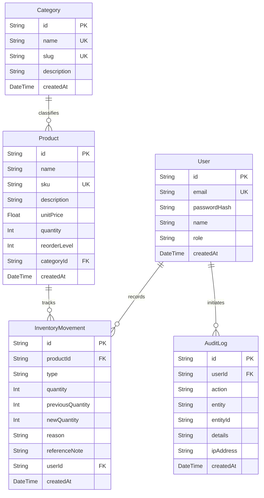

# System Design & Architecture Document
## Uchenna Inventory Management System — iGkings Innovation

**Project Owner:** Uchenna  
**Company:** iGkings Innovation (Systems • Web • Creative Solutions)  
**Document Version:** 1.0.0 (Capstone Edition)  
**Target Environment:** Local Node.js / PostgreSQL / Render Cloud Deployment  

---

## 1. Architectural Overview

The **Uchenna Inventory Management System** is a commercial-grade, multi-tier SaaS web application engineered to solve end-to-end inventory tracking, stock movements, category management, and audit compliance for enterprise operations.

The system is designed with a strict separation of concerns across a decoupled client-server architecture:

```
┌─────────────────────────────────────────────────────────────┐
│                       Client (React + Vite)                 │
│  - Presentation Pages: Login, Dashboard, Products, Category │
│  - Reusable Components: DataTables, StatCards, Badges       │
│  - Responsive Navigation: Collapsible Sidebar, Sticky Top   │
│  - Design Tokens: CSS Custom Properties (--color-navy, etc) │
└──────────────────────────────┬──────────────────────────────┘
                               │ HTTPS / JSON / Cookies
                               ▼
┌─────────────────────────────────────────────────────────────┐
│                 Server API (Node.js + Express)              │
│  - REST Controllers & Routers                               │
│  - Authentication: JWT + Secure HTTP-only cookies           │
│  - Rate Limiting, CORS, Security Headers (Helmet)           │
│  - Business Validation & Transactions ($transaction)        │
└──────────────────────────────┬──────────────────────────────┘
                               │ Prisma ORM
                               ▼
┌─────────────────────────────────────────────────────────────┐
│             Persistent Database (PostgreSQL / Prisma)       │
│  - Models: Users, Categories, Products, Movements, Logs     │
│  - Relational Integrity, Foreign Keys, Indexes              │
│  - Idempotent Seed Scripts & Migration History              │
└─────────────────────────────────────────────────────────────┘
```

---

## 2. Branding and Design System

The application design faithfully adopts the visual hierarchy of the provided reference dashboard and integrates the official **iGkings Innovation** identity.

### 2.1 Brand Tokens (`client/src/styles/tokens.css`)

| Token Name | Hex Value | Purpose / Semantic Usage |
| :--- | :--- | :--- |
| `--color-navy` | `#06274B` | Primary brand anchor: headers, sidebar active states, table headings |
| `--color-orange` | `#FF941F` | Action accent: primary call-to-actions, focus rings, interactive highlights |
| `--color-green` | `#159A63` | Positive inventory indicators: `Stock In` movements, healthy stock levels |
| `--color-bg` | `#F7F9FC` | Clean workspace surface background |
| `--color-surface` | `#FFFFFF` | Card containers, modal sheets, table row surfaces |
| `--color-text-primary`| `#152238` | Main typographic headings, primary values |
| `--color-text-secondary`| `#667085`| Subtitles, timestamps, metadata labels |
| `--color-border` | `#E4E9F0` | Dividers, card frames, input outlines |
| `--color-warning` | `#D97706` | Warning status: `Low Stock` threshold alerts |
| `--color-danger` | `#DC2626` | Urgent action: `Out of Stock`, deletion prompts |

### 2.2 Asset Config & Proportions

The official iGkings Innovation logo is preserved in high definition without redrawing or distortion:
- **Location:** `client/public/images/igkings-logo.png`
- **Configurable Module:** `client/src/utils/constants.js` via `BRAND.logoUrl`
- **Display Rules:** Rendered with fixed height bounds (`height: 42px`) and `object-fit: contain` to preserve pristine typography and icon proportions.

---

## 3. Database Schema Design (Prisma ORM)



### 3.1 Business Rules & Stock Calculation

1. **Stock Status State Machine:**
   - **Out of Stock (`OUT_OF_STOCK`):** `quantity === 0`  
     *Visual:* Crimson badge with red dot.
   - **Low Stock (`LOW_STOCK`):** `quantity > 0 && quantity <= reorderLevel`  
     *Visual:* Amber badge with yellow dot. Triggers dashboard attention banner.
   - **In Stock (`IN_STOCK`):** `quantity > reorderLevel`  
     *Visual:* Emerald green badge with green dot.
2. **Atomic Inventory Adjustment Transactions:**
   - Every stock alteration (`IN`, `OUT`, `ADJUSTMENT`) is executed inside an atomic `prisma.$transaction`.
   - Outgoing dispatches verify available stock: `previousQuantity >= requestedQuantity`. If insufficient, throws `400 Bad Request`.
   - The transaction atomically updates `Product.quantity`, writes an immutable `InventoryMovement` row, and records an `AuditLog` entry.
3. **Safe Category Deletion:**
   - Prevents orphaned products by blocking category deletion if `productCount > 0`. Prompts the user with reclassification guidance.

---

## 4. Component Hierarchy

```text
App
├── AuthProvider (User session state, JWT refresh)
│   └── ToastProvider (Global notification toasts)
│       └── Routes
│           ├── Login (Branded auth portal, Demo one-click fill)
│           └── AppLayout (Authenticated shell)
│               ├── Sidebar (Logo, Search, Navigation, Warehouses, Pro Card, User Footer)
│               ├── Topbar (Breadcrumbs, Last updated timestamp, Export CSV, Add Product)
│               └── Main Page Area
│                   ├── Dashboard (StatCards, MovementChart, RecentMovements, WarehouseOverview)
│                   ├── Products (FilterBar, DataTable, Modals: Create, Edit, Detail, Adjust, Delete)
│                   └── Categories (FilterBar, DataTable, Modals: Create, Edit, Detail, Delete)
```

---

## 5. Security & Deployment Architecture

- **Session Authentication:** Signed JSON Web Tokens (JWT) transmitted via HTTP-only cookies (`SameSite: Lax`/`None`, `Secure` in production) preventing XSS token harvesting.
- **Password Protection:** Cryptographic hashing with `bcryptjs` (salt rounds: 10).
- **Rate Limiting:** IP-based request throttling on authentication routes (`express-rate-limit`) preventing brute force credential attacks.
- **Security Headers:** Strict Content Security Policy and HTTP hardening via `helmet`.
- **CORS Configuration:** Explicit origin whitelisting allowing authorized client domains and Render app subdomains.
- **Production Asset Pipeline:** Express serves pre-compiled Vite production bundle from `client/dist` with client-side SPA routing fallback.
